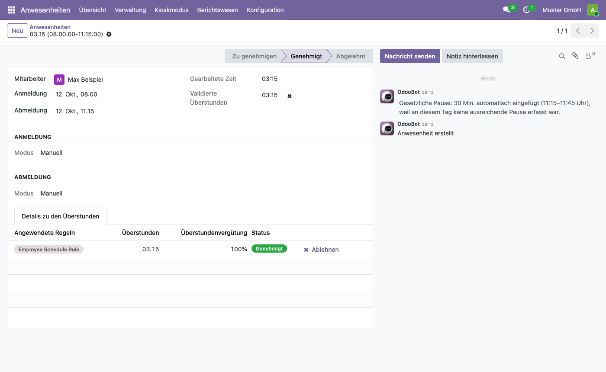
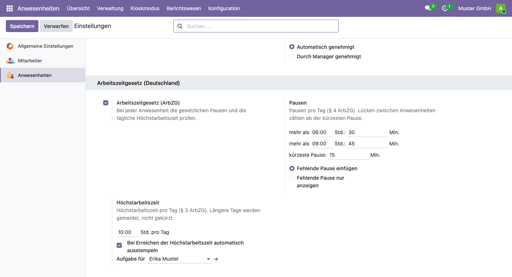
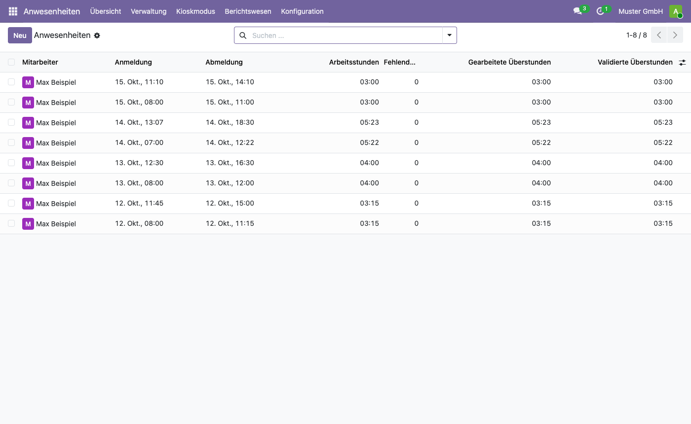

# Arbeitszeitgesetz für Odoo
<!-- /!\ Non OCA Context : Set here the badge of your runbot / runboat instance. -->

<!-- /!\ Non OCA Context : Set here the badge of your translation instance. -->

<!-- /!\ do not modify above this line -->

Pausen und Höchstarbeitszeit nach dem Arbeitszeitgesetz (ArbZG) direkt in den
Anwesenheiten von Odoo 19: Fehlt die gesetzliche Pause, wird sie eingefügt oder angezeigt,
über 10 Stunden Arbeit am Tag bekommen Mitarbeiter und Zuständige eine Meldung, und ein
vergessenes Ausstempeln endet bei der Höchstarbeitszeit.

> **Alpha:** Die Regeln laufen so seit September 2026 bei der Baumgärtner Marketing GmbH,
> als Modul sind sie neu. Das Modul ersetzt keine Rechtsberatung; die Software wird ohne
> Gewährleistung bereitgestellt (AGPL-3.0, Abschnitte 15 und 16).

## Was das Modul tut

- **Pausen (§ 4 ArbZG):** über 6 Stunden Arbeit am Tag 30 Minuten, über 9 Stunden 45
  Minuten. Lücken ab 15 Minuten zählen als Pause, ebenso die Pausen des Arbeitszeitplans,
  die Odoo abzieht. Verlangt wird nur die Zeit über der Grenze: 6:10 Stunden brauchen
  10 Minuten Pause.
- **Fehlende Pause:** Sie wird in die Mitte der längsten Anwesenheit des Tages gelegt und
  dort vermerkt – oder nur angezeigt, mit einer Nachricht an den Mitarbeiter.
- **Höchstarbeitszeit (§ 3 ArbZG):** Mehr als 10 Stunden Arbeit am Tag werden nicht
  gekürzt, weil die Aufzeichnung die tatsächliche Zeit zeigen muss (§ 16 Abs. 2 ArbZG).
  Der Mitarbeiter bekommt eine Nachricht, die zuständige Person eine Aufgabe, einmal je
  Tag.
- **Vergessenes Ausstempeln:** Eine geplante Aktion stempelt alle 15 Minuten aus, wer die
  Höchstarbeitszeit des Tages erreicht hat.
- **Korrekturen:** Jede Änderung prüft den ganzen Tag neu. Wer eine eingefügte Pause
  entfernt, bekommt sie zurück; wer später eine kürzere echte Pause einträgt, bekommt nur
  den Rest ergänzt.
- **Ausnahmen:** Auftragnehmer und Freiberufler sowie markierte Mitarbeiter, etwa
  Geschäftsführer und leitende Angestellte (§ 18 ArbZG), werden nicht geprüft.

Alle Grenzen sind je Firma einstellbar, falls sich das Gesetz ändert.

## Einrichtung

1. Unter *Apps* „Germany Working Time Act“ installieren; das Modul braucht die App
   *Anwesenheiten*.
2. *Anwesenheiten → Konfiguration → Einstellungen*, Block *Arbeitszeitgesetz
   (Deutschland)*: Grenzen prüfen, „Fehlende Pause einfügen“ oder „nur anzeigen“ wählen
   und festlegen, wer bei überschrittener Höchstarbeitszeit eine Aufgabe bekommt (leer:
   der Genehmiger der Anwesenheiten).
3. Am Mitarbeiter, neben dem Genehmiger der Anwesenheiten: „Nicht unter dem
   Arbeitszeitgesetz“ für Geschäftsführer und leitende Angestellte.

## Im Alltag

- Pausen am besten stempeln (Abmelden, Anmelden) oder beim Nachtragen als Lücke eintragen.
  Die Regel ist nur das Netz.
- Im Modus „nur anzeigen“ zeigt die Spalte *Fehlende Pause (Minuten)* der
  Anwesenheitsliste, wo etwas fehlt.

## Grenzen

- Geprüft wird die Summe der Pausen am Tag, nicht die sechs Stunden „hintereinander“ aus
  § 4 Satz 3 ArbZG.
- Nicht geprüft werden die Ruhezeit (§ 5), Sonn- und Feiertage (§§ 9–11), Nachtarbeit
  (§ 6), die Wochenarbeitszeit, der Jugendarbeitsschutz und tarifliche Abweichungen (§ 7).

## Mehr Dokumentation

Die Beschreibung des Moduls (englisch) steht in
[l10n_de_hr_attendance_arbzg/README.rst](l10n_de_hr_attendance_arbzg/README.rst).

*English: Legal breaks and the daily maximum working time of the German Working Time Act
(ArbZG) for the attendances of Odoo 19: missing breaks are inserted or pointed out, more
than 10 hours of work a day are reported, forgotten check-outs end at the maximum. Alpha,
no legal advice, no warranty.*

<!-- /!\ do not modify below this line -->

<!-- prettier-ignore-start -->

[//]: # (addons)

Available addons
----------------
addon | version | maintainers | summary
--- | --- | --- | ---
[l10n_de_hr_attendance_arbzg](l10n_de_hr_attendance_arbzg/) | 19.0.1.0.0 |  | Legal breaks and the daily maximum of the German Working Time Act (ArbZG) for attendances

[//]: # (end addons)

<!-- prettier-ignore-end -->

## Licenses

This repository is licensed under [AGPL-3.0](LICENSE).

However, each module can have a totally different license, as long as they adhere to Baumgärtner Marketing GmbH
policy. Consult each module's `__manifest__.py` file, which contains a `license` key
that explains its license.

----
<!-- /!\ Non OCA Context : Set here the full description of your organization. -->
