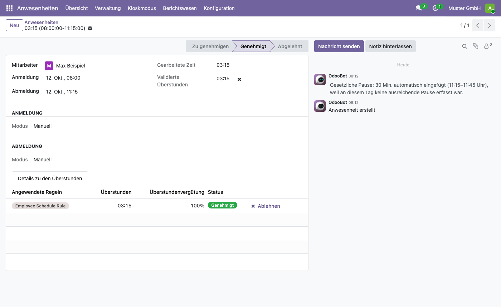
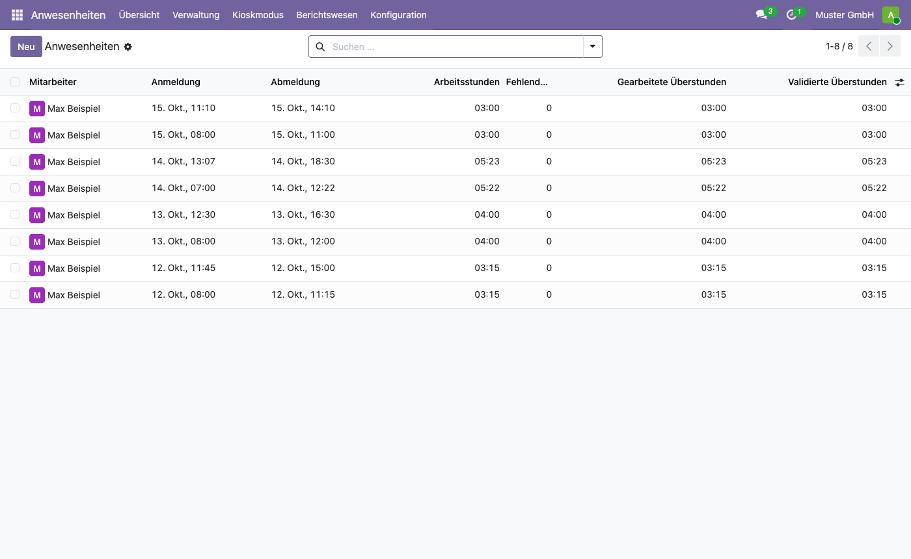

# Arbeitszeitgesetz für Odoo
<!-- /!\ Non OCA Context : Set here the badge of your runbot / runboat instance. -->

<!-- /!\ Non OCA Context : Set here the badge of your translation instance. -->

<!-- /!\ do not modify above this line -->

Dieser Zweig ist für **Odoo 20** und enthält zwei Module: das **Arbeitszeitkonto** und das
Modul zum **Arbeitszeitgesetz** (Pausen, Höchstarbeitszeit). Das Modul zum Arbeitszeitgesetz
für Odoo 19 steht im Zweig
[19.0](https://github.com/BM1-de/odoo-l10n-germany-arbzg/tree/19.0).

## Arbeitszeitkonto (Odoo 20)

Ein Arbeitszeitkonto mit Mehr- und Minusstunden für die Anwesenheiten von Odoo 20: Je Tag,
Woche oder Monat wird die gearbeitete Zeit mit dem Soll aus dem Arbeitszeitmodell
verglichen und die Abweichung als Plus oder Minus gebucht. Der Saldo kann ins Minus gehen.

Odoo 19 führte so einen Saldo als „Überstunden“. Odoo 20 hat ihn durch Zeitregeln ersetzt,
die Anwesenheiten teilen, für fehlende Zeit eigene Zeilen eintragen und keinen Saldo unter
null kennen. Dieses Modul bringt das Konto zurück und **liest die Anwesenheiten nur**:
Beginn, Ende und Dauer der Arbeitszeit bleiben so, wie sie erfasst wurden.

> **Alpha, ohne Gewähr:** Das Modul ersetzt keine Rechtsberatung und keine Vereinbarung mit
> den Beschäftigten. Ob ein Arbeitszeitkonto mit Minusstunden zulässig ist, hängt von den
> Verträgen ab. Die Software wird ohne Gewährleistung bereitgestellt (AGPL-3.0, Abschnitte
> 15 und 16).

- **Rechnung:** Ist aus den bestätigten Anwesenheiten, Soll aus dem Arbeitszeitmodell des
  am jeweiligen Tag gültigen Vertragsstands. Feiertage, Urlaub und Krankheit senken das
  Soll und lassen das Konto unberührt.
- **Toleranz:** Abweichungen innerhalb der Toleranz werden mit null gebucht, darüber die
  ganze Abweichung.
- **Minusstunden** nur, wenn es am Vertragsstand eingeschaltet ist. Einzelne Zeiträume
  lassen sich mit Begründung auf null stellen, etwa wenn der Arbeitgeber keine Arbeit hatte.
- **Tage ohne Anwesenheit** und ohne Abwesenheit werden nicht sofort als Minus gebucht. Sie
  warten als „zu klären“, bis die Abwesenheit nachgetragen oder das Minus bestätigt ist.
- **Freizeitausgleich:** Abwesenheitsarten mit „wird vom Arbeitszeitkonto abgebucht“ lassen
  das Soll stehen, der Tag bucht ins Minus.
- **Buchungen von Hand:** Vortrag, Korrektur, Auszahlung, Verfall, immer mit Grund. Gelöscht
  wird nichts, storniert wird per Gegenbuchung.
- **Monatsabschluss:** Abgeschlossene Monate werden nicht neu berechnet. Spätere Änderungen
  erscheinen als Korrektur im offenen Monat.
- **§ 2 Abs. 2 MiLoG:** je Vertragsstand einschaltbare Überwachung für Konten nach dem
  Mindestlohngesetz, etwa bei Minijobs: Hinweis, wenn Plusstunden zwölf Monate alt werden
  oder ein Monat mehr als die Hälfte der vereinbarten Arbeitszeit aufs Konto bringt.
- **Nachweise als PDF:** Kontoauszug und Arbeitszeitnachweis (Beginn, Ende, Dauer je Tag)
  je Mitarbeiter, zum Ablegen bei den Lohnunterlagen (§ 17 MiLoG, § 8 Abs. 2 Nr. 13 BVV).
- **Umstieg von Odoo 19:** Die Überstunden aus Odoo 19 werden Zeile für Zeile übernommen,
  der Saldo jedes Mitarbeiters bleibt derselbe.

Nicht enthalten: Löhne und Zuschläge, die Verdienstgrenze bei Minijobs, Langzeitkonten
(Wertguthaben nach § 7b SGB IV), Ampelgrenzen und automatischer Verfall. Einrichtung und
Bedienung (englisch):
[l10n_de_hr_attendance_time_account/README.rst](l10n_de_hr_attendance_time_account/README.rst).

*English: a signed working time account (plus and minus hours) for the attendances of
Odoo 20, computed from attendances and the working schedule, with entries by hand, month
closing, monitoring of § 2 (2) MiLoG, account statements and records of working time as PDF,
and the take over of the overtime of Odoo 19. Alpha, no legal advice, no warranty.*

## Arbeitszeitgesetz (Odoo 20)

Pausen und Höchstarbeitszeit nach dem Arbeitszeitgesetz (ArbZG) direkt in den
Anwesenheiten von Odoo 20: Fehlt die gesetzliche Pause, wird sie eingefügt oder angezeigt,
über 10 Stunden Arbeit am Tag bekommen Mitarbeiter und Zuständige eine Meldung, und ein
vergessenes Ausstempeln endet bei der Höchstarbeitszeit.

> **Alpha:** Die Regeln laufen so seit September 2026 bei der Baumgärtner Marketing GmbH,
> als Modul sind sie neu. Das Modul ersetzt keine Rechtsberatung; die Software wird ohne
> Gewährleistung bereitgestellt (AGPL-3.0, Abschnitte 15 und 16).

*Die Bilder zeigen noch die Fassung für Odoo 19; die Masken von Odoo 20 sehen etwas anders
aus.*

## Was das Modul tut

- **Pausen (§ 4 ArbZG):** über 6 Stunden Arbeit am Tag 30 Minuten, über 9 Stunden 45
  Minuten. Lücken ab 15 Minuten zählen als Pause, ebenso die Pausendauer, die an einer
  Anwesenheit eingetragen ist und die Odoo abzieht. Verlangt wird nur die Zeit über der
  Grenze: 6:10 Stunden brauchen 10 Minuten Pause.
- **Fehlende Pause:** Sie wird in die Mitte der längsten Anwesenheit des Tages gelegt und
  dort vermerkt – oder nur angezeigt, mit einer Nachricht an den Mitarbeiter.
- **Höchstarbeitszeit (§ 3 ArbZG):** Mehr als 10 Stunden Arbeit am Tag werden nicht
  gekürzt, weil die Aufzeichnung die tatsächliche Zeit zeigen muss (§ 16 Abs. 2 ArbZG).
  Der Mitarbeiter bekommt eine Nachricht, die zuständige Person eine Aufgabe, einmal je
  Tag.
- **Vergessenes Ausstempeln:** Eine geplante Aktion stempelt alle 15 Minuten aus, wer die
  Höchstarbeitszeit des Tages erreicht hat.
- **Korrekturen:** Jede Änderung prüft den ganzen Tag neu. Wer eine eingefügte Pause
  entfernt, bekommt sie zurück; wer später eine kürzere echte Pause einträgt, bekommt nur
  den Rest ergänzt.
- **Zeitregeln von Odoo 20:** Die Pause wird eingefügt, bevor die Zeitregeln den Tag
  auswerten. Aus 8:00 bis 18:00 Uhr bei 8 Stunden Soll werden 8:00 bis 12:37, 13:22 bis
  16:45 und 1:15 Stunden Mehrarbeit von 16:45 bis 18:00 Uhr. Abgelehnte Anwesenheiten und
  die Zeilen, die Odoo für fehlende Zeit einträgt, zählen nicht als Arbeit.
- **Ausnahmen:** Markierte Mitarbeiter, etwa Geschäftsführer und leitende Angestellte
  (§ 18 ArbZG), und Mitarbeiter eines markierten Mitarbeitertyps, etwa Auftragnehmer und
  Freiberufler, werden nicht geprüft.

Alle Grenzen sind je Firma einstellbar, falls sich das Gesetz ändert.

## Einrichtung

1. Unter *Apps* „Germany Working Time Act“ installieren; das Modul braucht die App
   *Anwesenheiten*.
2. *Anwesenheiten → Konfiguration → Einstellungen*, Block *Arbeitszeitgesetz
   (Deutschland)*: Grenzen prüfen, „Fehlende Pause einfügen“ oder „nur anzeigen“ wählen
   und festlegen, wer bei überschrittener Höchstarbeitszeit eine Aufgabe bekommt (leer:
   der Genehmiger der Anwesenheiten).
3. Am Mitarbeiter, neben dem Genehmiger der Anwesenheiten: „Nicht unter dem
   Arbeitszeitgesetz“ für Geschäftsführer und leitende Angestellte.
4. Am Mitarbeitertyp (*Mitarbeiter → Konfiguration → Mitarbeitertypen*): „Nicht unter dem
   Arbeitszeitgesetz“ für Typen, die keine Arbeitnehmer sind, etwa Auftragnehmer und
   Freiberufler. Odoo 20 kennt dafür keine festen Typen mehr; ohne Haken wird jeder Typ
   geprüft. Beim Umstieg von Odoo 19 setzt das Modul den Haken an den Typen, die die
   bisherigen Auftragnehmer und Freiberufler bekommen haben; teilt sich einer von ihnen
   den Typ mit anderen, bekommt stattdessen er selbst den Haken am Mitarbeiter.

## Im Alltag

- Pausen am besten stempeln (Abmelden, Anmelden) oder beim Nachtragen als Lücke eintragen.
  Die Regel ist nur das Netz.
- Im Modus „nur anzeigen“ zeigt die Spalte *Fehlende Pause (Minuten)* der
  Anwesenheitsliste, wo etwas fehlt.

## Grenzen

- Geprüft wird die Summe der Pausen am Tag, nicht die sechs Stunden „hintereinander“ aus
  § 4 Satz 3 ArbZG.
- Nicht geprüft werden die Ruhezeit (§ 5), Sonn- und Feiertage (§§ 9–11), Nachtarbeit
  (§ 6), die Wochenarbeitszeit, der Jugendarbeitsschutz und tarifliche Abweichungen (§ 7).
- Odoo 20 zieht die Mittagspause des Arbeitszeitplans nicht mehr von der Arbeitszeit ab.
  Eine Anwesenheit von 8:00 bis 17:00 Uhr sind dort 9 Stunden Arbeit, und die Pause wird
  eingefügt; Odoo 19 rechnete die Stunde des Plans an.
- „Pausenverwaltung bei Abmeldung“ von Odoo 20 fragt die Pause erst nach dem
  Ausstempeln ab. Mit „Fehlende Pause einfügen“ steht die gesetzliche Pause dann schon in
  der Anwesenheit, und eine danach eingetragene Pause wird zusätzlich abgezogen; dazu passt
  „nur anzeigen“.
- Odoo nimmt Zeilen, die seine Zeitregeln abgespalten haben, nicht zurück. Wird in einen
  Tag mit solchen Zeilen später eine Pause eingefügt, weil der Tag korrigiert wurde,
  bleiben sie, wie sie sind.

## Mehr Dokumentation

Die Beschreibung des Moduls (englisch) steht in
[l10n_de_hr_attendance_arbzg/README.rst](l10n_de_hr_attendance_arbzg/README.rst).

*English: Legal breaks and the daily maximum working time of the German Working Time Act
(ArbZG) for the attendances of Odoo 20: missing breaks are inserted or pointed out, more
than 10 hours of work a day are reported, forgotten check-outs end at the maximum. Alpha,
no legal advice, no warranty.*

<!-- /!\ do not modify below this line -->

<!-- prettier-ignore-start -->

[//]: # (addons)

Available addons
----------------
addon | version | maintainers | summary
--- | --- | --- | ---
[l10n_de_hr_attendance_arbzg](l10n_de_hr_attendance_arbzg/) | 20.0.1.0.0 |  | Legal breaks and the daily maximum of the German Working Time Act (ArbZG) for attendances
[l10n_de_hr_attendance_time_account](l10n_de_hr_attendance_time_account/) | 20.0.1.0.0 |  | Signed working time account (plus and minus hours) from attendances, with statements for German payroll records

[//]: # (end addons)

<!-- prettier-ignore-end -->

## Licenses

This repository is licensed under [AGPL-3.0](LICENSE).

However, each module can have a totally different license, as long as they adhere to Baumgärtner Marketing GmbH
policy. Consult each module's `__manifest__.py` file, which contains a `license` key
that explains its license.

----
<!-- /!\ Non OCA Context : Set here the full description of your organization. -->

<!-- bm1-verweise:start (scripts/readme-bm1.py, nicht von Hand ändern) -->

## Weitere Odoo-Projekte von BM1

| Projekt | Zweck |
| ------- | ----- |
| [Cc und Bcc](https://github.com/BM1-de/odoo-mail-cc-bcc) | Cc und Bcc beim Mailversand, eine einzige E-Mail an alle Empfänger |
| [Briefanrede](https://github.com/BM1-de/odoo-partner-salutation) | Anrede am Kontakt und die passende Grußzeile in Rechnungsmails |
| [Namenszusatz](https://github.com/BM1-de/odoo-partner-name-addition) | Zweite Namenszeile am Kontakt, gedruckt in jeder Anschrift |
| [Stundennachweis auf der Rechnung](https://github.com/BM1-de/odoo-timesheet-invoice) | Abgerechnete Zeiteinträge auf der Rechnung, je Aufgabe summiert |
| [Deutsche EÜR](https://github.com/BM1-de/odoo-l10n-germany-euer) | Einnahmenüberschussrechnung mit Anlage EÜR, AVEÜR und Anlagenverzeichnis |
| [Papierkram-Import](https://github.com/BM1-de/odoo-papierkram-import) | Kontakte, Rechnungen, Belege, Zahlungen und Zeiten aus Papierkram übernehmen |
| [Zeiterfassung für Odoo (macOS)](https://github.com/BM1-de/timesheets-for-odoo) | Menüleisten-App für Zeiten und Anwesenheit |
| [Zeiterfassung für Odoo (Windows)](https://github.com/BM1-de/timesheets-for-odoo-windows) | App im Infobereich für Zeiten und Anwesenheit |

## Über BM1

<a href="https://bm1.de"><picture><source media="(prefers-color-scheme: dark)" srcset="docs/bm1/logo-bm1-negativ.svg"></picture></a>

Entwickelt und gepflegt von [BM1](https://bm1.de), der Baumgärtner Marketing GmbH aus
Bayreuth: Agentur für [Websites](https://bm1.de/websites/),
[Webentwicklung](https://bm1.de/webentwicklung/), [SEO](https://bm1.de/seo/) und
[individuelle digitale Lösungen](https://bm1.de/digitale-spezial-themen/). Wir arbeiten selbst
jeden Tag mit Odoo und bauen, was uns dort fehlt. Wenn Sie Unterstützung bei Odoo, einer
Website oder einer Anbindung brauchen, die es nicht von der Stange gibt:
[sprechen Sie uns an](https://bm1.de/kontakt/).

<!-- bm1-verweise:end -->
